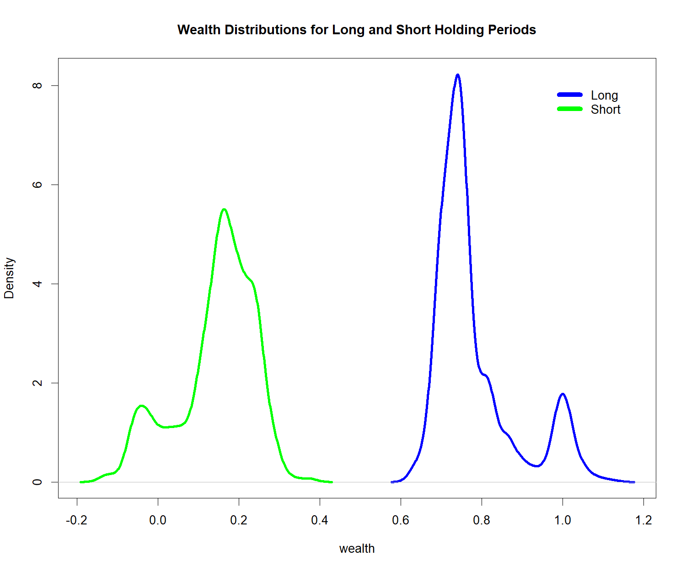
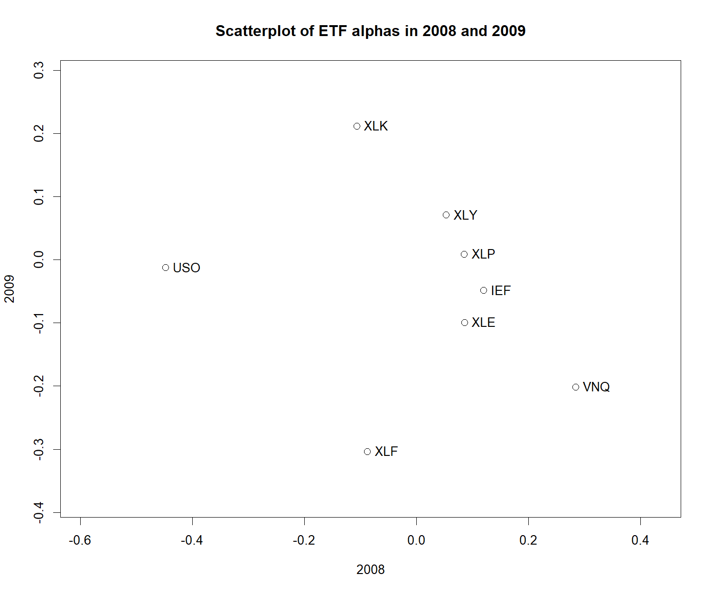

# FRE7241 Homework 1

**Panagiotis Housos | Algorithmic Portfolio Management | Fall 2026**

Stock/bond allocation using a paired historical block bootstrap, followed by
CAPM statistics and ETF alpha rankings for 2006-2026.

**[PDF report](report/Panagiotis_Housos_HW1_Report.pdf)** |
[LaTeX source](report/Panagiotis_Housos_HW1_Report.tex) |
[R submission](Panagiotis_Housos_hw1.R) |
[Numerical checks](hw1_results/verification.txt)

## Results

- Approximately ten-year allocation: **45.4324% VTI / 54.5676% IEF**.
- VTI weights across the five holding blocks: **41.27%, 35.97%, 41.61%,
  45.88%, and 43.23%**. The weights do not increase monotonically.
- Annualized alpha and ranking matrices: **8 ETFs x 21 intervals**.
- Correlation between 2008 and 2009 alphas: **-0.2393**.





The report contains the calculations, figures, annual CAPM tables, alpha and
ranking matrices, and submitted R code. CSV and RDS exports include the
simulation draws and input data subsets. The numerical checks compare the
optimized weights with the solution from asset moments and the CAPM estimates
with direct OLS regressions.

## Run the code

The reference environment uses R 4.6.1, `rutils` 0.2,
`PerformanceAnalytics` 2.1.0, `RobStatTM` 1.0.11, and `png` 0.1-9.
Compiling the report also requires `pdflatex`.

Run commands from the repository root. Install missing R packages first:

```sh
Rscript --vanilla setup.R
```

New installations of the two course GitHub packages use the recorded commits.
Existing installations are retained. Package versions and input data hashes are
recorded in [`reproducibility/`](reproducibility/).

Run the submitted assignment independently:

```sh
Rscript --vanilla Panagiotis_Housos_hw1.R
```

On Windows, rebuild the analysis, numerical checks, environment records, and PDF:

```powershell
powershell -ExecutionPolicy Bypass -File build.ps1
```

Use `-SkipAnalysis` to compile the PDF from the existing exported results.
The individual build commands are:

```sh
Rscript --vanilla hw1_results/verify_hw1.R
Rscript --vanilla report/export_results.R
Rscript --vanilla reproducibility/record_environment.R
cd report
pdflatex -interaction=nonstopmode -halt-on-error Panagiotis_Housos_HW1_Report.tex
pdflatex -interaction=nonstopmode -halt-on-error Panagiotis_Housos_HW1_Report.tex
```

## Files

| Location | Contents |
| --- | --- |
| `Panagiotis_Housos_hw1.R` | Questions and completed R solutions |
| `FRE7241_hw1.R` | Professor's original template |
| Root PNG files | Professor's reference figures |
| `report/` | PDF, LaTeX source, export script, vector figures, and tables |
| `hw1_results/` | PNG figures, console output, and numerical checks |
| `hw1_results/tables/` | Scenarios, input subsets, CAPM tables, alphas, rankings, and RDS results |
| `reproducibility/` | Package versions, session information, and data hashes |
| `setup.R`, `build.ps1` | Package installation and report build scripts |

## Conventions and limitations

The assignment's "wealth" is a weighted cumulative log return. A holding block
of `h` price observations spans `h - 1` return intervals. Each bootstrap draw
uses the same historical block for both ETFs and samples from all valid starts.
Overlapping historical windows do not supply independent market histories.

CAPM windows include both neighboring endpoint rows, following the assignment's
example. Adjacent windows therefore share a boundary observation. VTI is the
benchmark and is excluded from the eight comparison ETFs. The first and last
years are partial.

The supplied daily returns are log returns. `table.CAPM()` annualizes the fitted
daily intercept as `(1 + intercept)^252 - 1`; this is the requested package
statistic, not an ETF's realized annual return. The large 2026 values extrapolate
the short final sample. The allocations and rankings describe the historical
sample rather than a tested predictive strategy.

`table.CAPM()` reports a convergence warning for VNQ's 2012 robust downside-beta
fit. Ordinary alpha, beta, annualized alpha, rankings, and the scatterplot are
unaffected. The warning is retained in the
[verification record](hw1_results/verification.txt) and
[execution warning file](hw1_results/tables/execution_warnings.txt).
